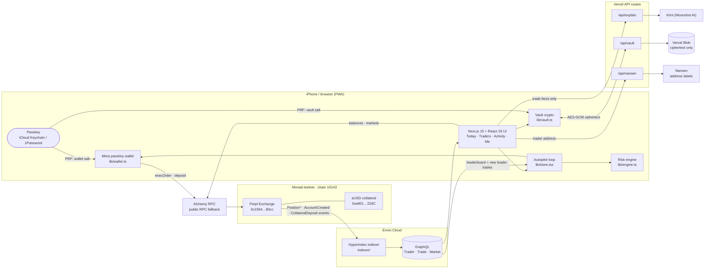
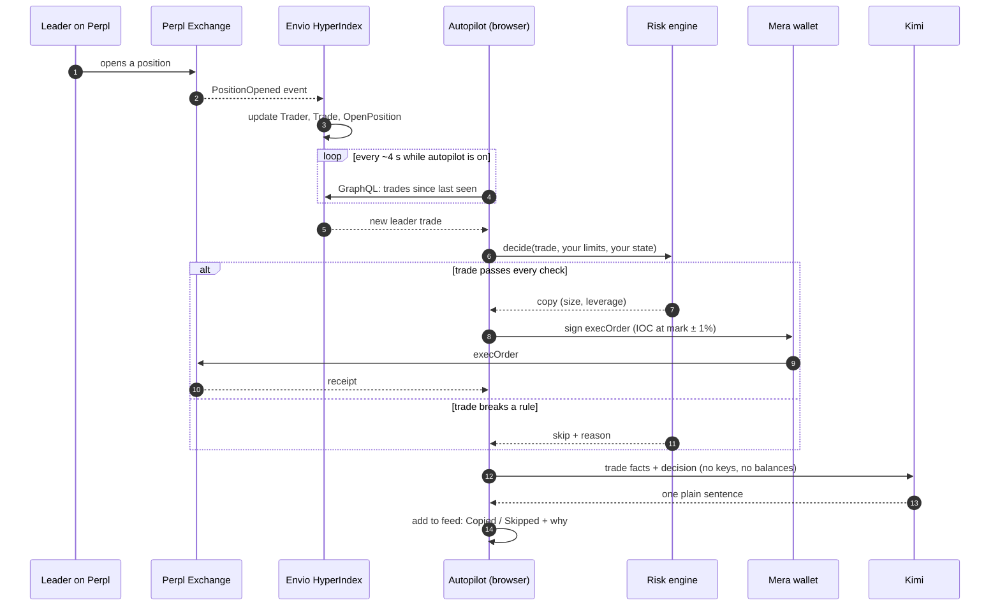
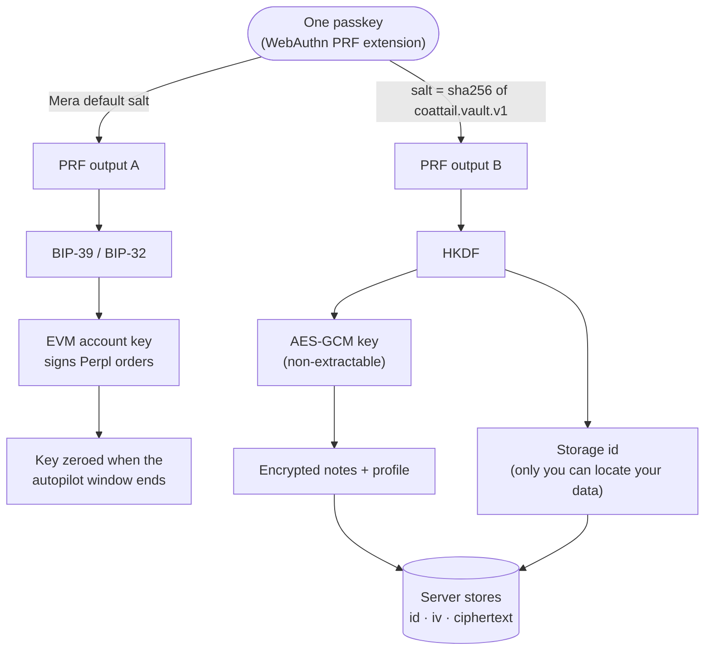

<div align="center">

# Coattail

**Copy proven Perpl traders on Monad. Your Face ID is the wallet. Your limits are the risk engine.**

[Live app](https://coattail-phi.vercel.app) · [Architecture](#architecture) · [Bounty map](#bounty-map) · [Resources used](#resources-used) · [Run it](#run-it)

Built for the **Monad Metropolis Hackathon** · Primary track: **Onchain Finance & Trading**

</div>

---

## The problem

Good perp traders exist, but a newcomer can't see how they think, and can't follow them without staring at charts all day. Wallets make it worse: seed phrases, browser extensions, and one wrong click can cost you everything.

## What Coattail does

Coattail is a mobile web app (installable on the iPhone home screen) for people who want exposure to good traders without watching charts.

1. **One passkey, one wallet.** A Mera passkey derives your Monad wallet from its PRF output. No seed phrase, no extension, no custody backend.
2. **Pick a real trader.** The leaderboard is built from Perpl's on-chain events by an Envio HyperIndex indexer, enriched with Nansen labels, and summarised in plain English by Kimi.
3. **Set your limits on a dial.** Max $ per trade, max leverage, a stop-loss, and an autopilot window.
4. **Autopilot mirrors their trades on Perpl** by sending `execOrder` straight to the Exchange contract, inside your limits. Every copy *and every skip* lands in your feed with a one-line reason.
5. **Private notes** are encrypted with a *second* key from the same passkey (a separate PRF salt). Open Coattail on a new device and your notes come back.

> **Track fit:** the Onchain Finance & Trading resources list *Social & Copy-Trading Interfaces* as an open lane ("no dominant copy-trading protocol exists on Monad yet"). Coattail also fits *Mobile-First Trading for a Specific Segment* (newcomers who don't want to watch charts).

---

## What is real today, and what is practice

We label everything that is not real. Nothing is presented as on-chain that isn't.

| Piece | Status |
|---|---|
| Mera passkey wallet, Face ID sign-in, same address on restore | **Real**, running on Monad testnet |
| Leaderboard and trade stream from Perpl events (Envio HyperIndex) | **Real**, live indexer on Envio Cloud |
| Wallet balances (MON, aUSD) and Perpl market reads | **Real**, read from chain through viem |
| Faucet MON, gas | **Real** |
| Risk engine decisions (copy / close / skip + reason) | **Real**, runs on every trade |
| Kimi plain-English explanations | **Real** (template fallback if the API is down) |
| Encrypted notes, cross-device restore | **Real**, ciphertext only on the server |
| Nansen Smart Money labels | **Real** API call; most testnet wallets have no labels |
| Copy orders (`execOrder`) | **Wired, not yet exercised on-chain.** A Perpl account needs a 100 aUSD first deposit and we have no test aUSD yet |
| Copies shown in the feed | **Practice mode**: a replay of the selected trader's *real past trades*, tagged "Practice · replay". Demo traders are tagged "Demo" |

Practice mode switches on automatically unless the indexer URL is set **and** your wallet has an open Perpl account **and** markets are loaded.

---

## Architecture

### System overview

<sub>If the diagrams don't render where you're reading this, see [`docs/architecture.png`](docs/architecture.png).</sub>



### Copy flow: one leader trade, end to end



### One passkey, many keys



The two key spaces come from different PRF salts, so they are cryptographically unrelated. The server never sees plaintext and cannot even compute where your data lives.

---

## Bounty map

Primary track: **Onchain Finance & Trading**. Sponsor bounties we are going for:

| Bounty | What Coattail does | Where |
|---|---|---|
| **Agora: Best Mobile Trading App on Monad** | Mobile PWA, Mera passkey login, aUSD balance (Perpl's collateral), trades sent to Perpl | `lib/wallet.ts`, `lib/perpl.ts`, `components/Home.tsx` |
| **Perpl: Best use of Perpl's API** | Copy-trading automation with risk caps: IOC orders with slippage bounds, per-trade cap, leverage cap, stop-loss, session window | `lib/engine.ts`, `lib/store.tsx`, `lib/perpl.ts` |
| **Perpl: Best Analytics / Risk Tool** | Trader leaderboard and wallet drill-down: win rate, profit factor, max drawdown, favourite market, recent trades | `indexer/`, `components/Home.tsx` |
| **Best Use of Envio** | HyperIndex indexer on Perpl's Exchange. Its GraphQL is the core data source for the leaderboard and the copy stream | `indexer/` |
| **Best use of Nansen** | Server-side address labels tag traders as Smart Money, cached 6 h so a refresh can't burn credits | `app/api/nansen/route.ts` |
| **Best Builds Powered by KIMI** | Plain-English "why" for every copy and skip, plus a one-line read on each trader | `app/api/explain/route.ts` |
| **Best Projects using Alchemy** | Alchemy is the primary Monad testnet RPC for every read and write, with the public RPC as automatic fallback | `lib/config.ts` |
| **Best Mera-Powered UX on Monad** | Mera is the entire account layer: no seed phrase, no extension, no custody backend. Sign in on a wiped browser and the same address returns | `lib/wallet.ts` |
| **Mera: One Passkey, Many Keys** | A second PRF namespace (`sha256("coattail.vault.v1")`) → HKDF → AES-GCM key and storage id. Notes and profile are end-to-end encrypted and restore across devices | `lib/vault.ts`, `app/api/vault/route.ts` |

### Envio in detail

`indexer/config.yaml` indexes Perpl's Exchange on Monad testnet (chain `10143`): `AccountCreated`, `CollateralDeposit`, `ContractAdded` / `ContractAddedV2`, `PositionOpened` / `PositionOpenedV2`, `PositionIncreased` / `PositionIncreasedV2`, `PositionDecreased`, `PositionClosed`, `PositionLiquidated`.

Handlers (`indexer/src/handlers/Exchange.ts`) build these entities (`indexer/schema.graphql`):

- **Trader**: realized PnL, wins and losses, gross profit and loss, peak PnL, max drawdown, average leverage, favourite market. Drives the leaderboard.
- **Trade**: one row per leader action (open or close, side, price, size, leverage, PnL). The copy engine polls it by trader and timestamp.
- **Market, PerplAccount, OpenPosition, TraderMarket**: decimals, account → address mapping, and the state needed to size closes.

The app reads this live from `indexer.dev.hyperindex.xyz`.

---

## How the risk engine works

`lib/engine.ts` is a pure, synchronous function. Every leader trade goes through the same checks, in order:

1. Is it the trader you follow?
2. Is it a close? Then close only if you hold a mirrored position in that market.
3. Is the autopilot window still open? (Mera sessions are in-memory keys. When the window ends the key is zeroed and the next action needs Face ID again.)
4. Is the market on your list?
5. Are you past your stop-loss?
6. Are you already copying a position in that market?
7. Size = min(your per-trade cap, what your free collateral can margin at your max leverage). Leverage = min(theirs, your cap).

Orders are immediate-or-cancel at mark ± 1%, so a copy can never fill worse than that bound.

---

## Resources used

From the Metropolis resources page, by what we actually built with.

**Primary track: Onchain Finance & Trading**
- Idea resources: *Social & Copy-Trading Interfaces* (the open lane we are building in)
- [Monad docs: differences from Ethereum](https://docs.monad.xyz/developer-essentials/differences) and the [developer essentials](https://docs.monad.xyz/developer-essentials/summary)
- [Mera guide](https://docs.monad.xyz/guides/mera) (passkey account layer)

**Perpl** (Agora trading, API and Analytics bounties)
- [Perpl docs: for developers](https://docs.perpl.xyz/resources/for-developers), [quickstart](https://docs.perpl.xyz/resources/for-developers/quickstart) and the networks and configuration page (contract addresses in `lib/config.ts`)
- We call the Exchange contract directly with viem and the contract ABI (`lib/abi.ts`) rather than the [Perpl SDK](https://docs.perpl.xyz/resources/for-developers/sdk)

**Envio**
- [HyperIndex overview](https://docs.envio.dev/docs/HyperIndex/overview), [quickstart](https://docs.envio.dev/docs/HyperIndex/quickstart) and [Index Monad data with Envio](https://docs.envio.dev/docs/HyperIndex/monad-testnet)
- HyperSync is the data source underneath the indexer: `https://monad-testnet.hypersync.xyz`

**Alchemy**
- [Monad API quickstart](https://www.alchemy.com/docs/reference/monad-api-quickstart) for the RPC endpoint format used in `lib/config.ts`

**Nansen and Kimi**
- Nansen Profiler API: `POST https://api.nansen.ai/api/v1/profiler/address/labels`
- Kimi (Moonshot AI) chat API through an OpenAI-compatible endpoint, `https://api.moonshot.ai/v1`

We did not claim any of the sponsor perks (Quicknode, Tenderly, Zerion and others).

---

## Run it

```bash
npm install
cp .env.example .env.local   # fill what you have, everything is optional
npm run dev
```

Passkeys need HTTPS (or `localhost`). PRF works with iCloud Keychain on iOS 18+ / macOS 15+ and with 1Password.

> **Passkeys are bound to the domain.** A passkey made on one URL won't work on another, so use the production domain for anything you care about.

### Environment

| Var | Needed for |
|---|---|
| `NEXT_PUBLIC_ENVIO_URL` | Live leaderboard and copy stream (Envio Cloud GraphQL URL) |
| `NEXT_PUBLIC_ALCHEMY_KEY` | Alchemy RPC (falls back to the public Monad RPC) |
| `NANSEN_API_KEY` | Smart Money labels |
| `MOONSHOT_API_KEY`, `MOONSHOT_BASE_URL`, `MOONSHOT_MODEL` | Kimi explanations (template fallback without a key) |
| `BLOB_READ_WRITE_TOKEN` | Durable cross-device vault storage (Vercel Blob). Without it the vault lives in server memory plus localStorage |

### Indexer

```bash
cd indexer
npm install
npm run codegen
ENVIO_API_TOKEN=... npm run dev   # local (needs Docker), or deploy to Envio Cloud from GitHub
```

### Try it on a phone

1. Open the live app in Safari on iOS 18+, tap **Share → Add to Home Screen**.
2. Walk through onboarding: approve Face ID to create your passkey wallet and pick up to three goals.
3. Get testnet MON from the [Monad faucet](https://faucet.monad.xyz) (the address is on the Me tab).
4. Open **Traders**, pick one, set your limits, and start autopilot.

## Repo layout

```
app/                 Next.js app router, PWA manifest
  api/explain/       Kimi narrator
  api/nansen/        Nansen label lookup (server-side key)
  api/vault/         ciphertext store (Vercel Blob)
components/          Onboarding, Home (Today / Traders / Activity / Me), UI kit
lib/
  wallet.ts          Mera passkey wallet + timed signing session
  vault.ts           second PRF key → AES-GCM notes
  engine.ts          pure risk engine
  perpl.ts           Exchange reads, deposits, execOrder
  store.tsx          app state + autopilot loop
  data.ts            leaderboard / trade queries (Envio GraphQL)
indexer/             Envio HyperIndex project for Perpl
```

## Stack

Next.js 15, React 19, framer-motion, viem, `@category-labs/mera`, Envio HyperIndex, Vercel Blob. Contracts on Monad testnet (10143): Perpl Exchange `0x1964C32f0bE608E7D29302AFF5E61268E72080cc`, aUSD `0xa9012a055bd4e0eDfF8Ce09f960291C09D5322dC`.

## Known limits (honest list)

- Autopilot runs while the app is open. There is no server holding your key, by design.
- Mera sessions don't natively scope permissions, so limits are enforced by Coattail's engine, not by the chain.
- The leaderboard's drawdown is realized-PnL drawdown relative to deposits, not mark-to-market.
- The first Perpl deposit must be at least 100 aUSD, and we have not yet had test aUSD, so `execOrder` copies have not been run on-chain.
- Practice replays use the leader's real past trades (hours to months old on testnet), so they show the engine working, not a live fill.
